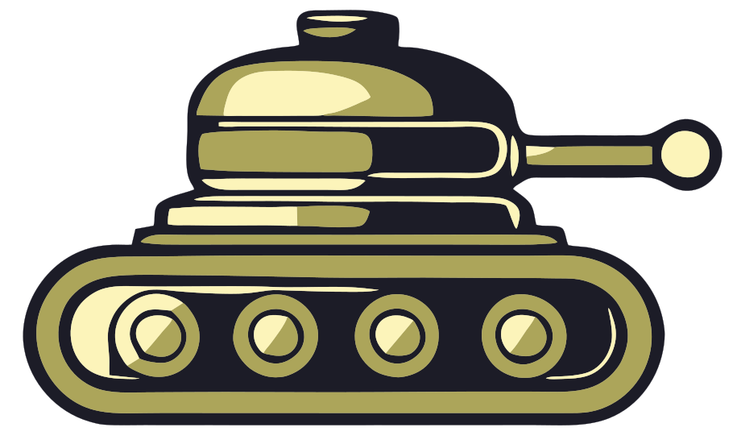

# Rusty Tanks

  

A two-player artillery game for the browser, inspired by classic tank games. Built from a clean slate: all code is original.

Play it: https://mrdahl.github.io/rusty-tanks/

## How to play
- Pick 1 Player (vs the computer: Easy, Normal or Hard) or 2 Players on one screen from the main menu.
- Then draft your weapons: players take turns picking 10 weapons each from a fresh random pool of 20 weapons (out of 52). A weapon that has been picked is gone for both players, and every new game reshuffles the pool. Each pick is one use in the battle.
- Loose dirt falls: overhangs and tunnel roofs collapse after every shot.
- Each turn: optionally drive a little (60 px per turn), set angle and power, choose a weapon and fire. Watch the wind.
- Hits earn points, hitting yourself loses points. Each player gets 10 shots.
- Pick a season on the menu (or Random). Each one changes the rules:
  - **Monsoon**: the ground turns to mud. A tank that does not drive during its turn sinks a little deeper (up to 12 px), and its shots get blocked by the dirt. Driving pulls it free.
  - **Ice Age**: tanks keep sliding after you stop driving, and bouncing shells bounce in wild directions.
  - **Thunderstorm**: 1-2 lightning bolts strike at the start of every turn. A tank that is hit loses 30 points.
  - **Hurricane**: very strong wind that turns around every turn.
  - **Apocalypse**: 3-4 meteors crash down at the start of every turn, digging craters. A tank that is hit loses 30 points.
  - In Thunderstorm and Apocalypse there is one last storm after Player 2's final turn, and only then is the winner announced, so Player 2 is not at a disadvantage.
  - **Normal**: no weather effects. **Random**: a season picked at random for every match.
  - The numbers are constants at the top of `game.js` (SINK_PER_TURN, STRIKE_DAMAGE, HURRICANE_WIND and so on), so they are easy to tune.

- Weapons have different explosion looks (fireballs, rings, sparks, dirt splats, electric arcs, fireworks, shockwaves) and dig holes of different shapes (wide, tall, diamond, star, cone, trench, bowl, ring and more).
- Dirt weapons (Mud Pie, Avalanche, Spire, Triple Mound, Landfill) can bury a tank. A buried tank cannot drive; it must dig itself out with its own weapons.
- The night sky sometimes has a moon and semi-transparent drifting clouds that the moon shines through.

Keys: left/right = angle, up/down = power (hold Shift for big steps), A / D = drive, 1-9 = choose weapon, Space = fire, N = rematch (same weapons), Esc = menu.

## Files
- `index.html`: page layout and styling
- `weapons.js`: the list of weapons (copy a line to invent a new one)
- `game.js`: the rules (terrain, physics, wind, scoring, turns, computer opponent)
- `fx.js`: the neon arcade effects (night city, rain, lightning, sparks, glowing shells, screen shake)
- `main.js`: drawing, menus, weapon draft and controls
