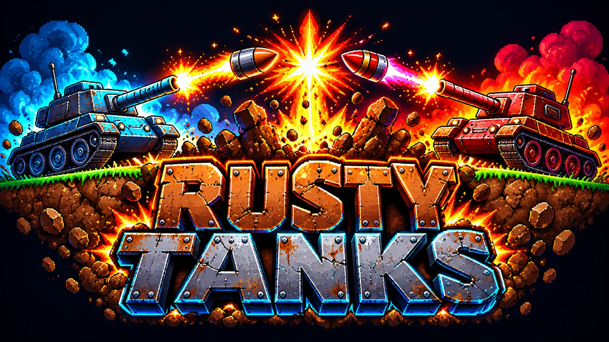

# Rusty Tanks

  

A two-player artillery game for the browser, inspired by classic tank games. Built from a clean slate: all code is original.

Play it: https://mrdahl.github.io/rusty-tanks/

## How to play
- Pick 1 Player (vs the computer: Easy, Normal or Hard) or 2 Players on one screen from the main menu.
- Press **Draft Battle** to draft your weapons, or **Quick Play** to start at once with 10 random weapons each. In the draft: players take turns picking 10 weapons each from a fresh random pool of 20 weapons (out of 61). A weapon that has been picked is gone for both players, and every new game reshuffles the pool. Each pick is one use in the battle.
- Loose dirt falls: overhangs and tunnel roofs collapse after every shot.
- Each turn: optionally drive a little (60 px per turn), set angle and power, choose a weapon and fire. Watch the wind.
- Hits earn points, hitting yourself loses points. Each player gets 10 shots.
- Pick a season on the menu (or Random). Each one changes the rules:
  - **Monsoon**: the ground turns to mud. A tank that does not drive during its turn sinks a little deeper (up to 12 px), and its shots get blocked by the dirt. Driving pulls it free.
  - **Ice Age**: tanks keep sliding after you stop driving, and bouncing shells bounce in wild directions.
  - **Thunderstorm**: 1-2 lightning bolts strike at the start of every turn. A tank that is hit loses 30 points.
  - **Hurricane**: very strong wind that turns around every turn.
  - **Apocalypse**: 3-4 meteors crash down at the start of every turn, digging craters. A tank that is hit loses 30 points.
  - In Thunderstorm and Apocalypse there is one last storm after Player 2's final turn, and only then is the winner announced, so Player 2 is not at a disadvantage.
  - **Normal**: no weather effects. **Random**: a season picked at random for every match.
  - The numbers are constants at the top of `game.js` (SINK_PER_TURN, STRIKE_DAMAGE, HURRICANE_WIND and so on), so they are easy to tune.

- **Elemental weapons** put effects on the tanks they catch:
  - **Frost Shell / Cryo Bomb** freeze the enemy turret: it cannot be aimed on that tank's next turn (power and driving still work). In the Monsoon the mud where it lands freezes into solid ice that blasts cannot dig and tanks cannot sink into.
  - **Napalm Shell / Fire Bomb / Lava Glob / Ember Rain** start flames that drop, run downhill into craters and burn for about 3 seconds (rain halves that in the Monsoon; fire also melts ice).
  - **Nuclear Warhead / Dirty Bomb** leave fallout: every tank inside the zone (also the shooter!) loses points at the start of each of its next 3 turns, and its controls are scrambled for one turn.
  - **EMP Pulse**: the victim can't drive or change power for a turn.
  - Burying an enemy in dirt, freezing or EMP-ing him earns bonus points. A tank that drops into a hole takes fall damage (credited to whoever dug the hole).
- Weapons have different explosion looks (fireballs, rings, sparks, dirt splats, electric arcs, fireworks, shockwaves) and dig holes of different shapes (wide, tall, diamond, star, cone, trench, bowl, ring and more).
- Dirt weapons (Mud Pie, Avalanche, Spire, Triple Mound, Landfill) can bury a tank. A buried tank cannot drive; it must dig itself out with its own weapons.
- The night sky sometimes has a moon and semi-transparent drifting clouds that the moon shines through.

- Sound: every sound is synthesized live in the browser (no sound files). Every weapon has its own launch sound, and each of the 16 explosion styles has its own boom. The music is a chiptune in the style of old keygen tracks (fast arpeggios, bouncy bass, pulse lead, noise drums), and every weather has its own hand-composed song that gets more intense with the weather: Normal is calm and relaxed (104 BPM), Monsoon is rainy and melancholy (116), Ice Age is cold and glassy (126), Thunderstorm drives with thunder rumbles (138), Hurricane is the fast one (150) and Apocalypse is the end of the world (172 BPM: gallop kicks, rumble, a falling bomb and sirens). The menus have their own calm track. The notes are plain text in `songs.js`, played by a small tracker in `sound.js`. Click anywhere once to switch sound on; the Sound and Music boxes (or the M key) turn them off again.

- When the match ends a **battle report** shows accuracy, damage, best shot, biggest crater, top weapon and more.
- The game fills the whole window (no scrolling): the battlefield and the control panel (angle, power, weapon, FIRE, drive, switches) are one screen that scales to fit. Press F or the fullscreen button for true fullscreen.

### Weapon icons

Every weapon has an icon on the draft cards and next to the weapon list. All 61 icons are packed in one picture, `assets/weapon-icons.webp` (8 per row, in the same order as `weapons.js`), so the game loads one small file. The artwork sheets (four 4x4 sheets, some spare icons left over) are kept in `assets/weapon-art/`, and `python3 tools/build_weapon_icons.py` cuts them up and rebuilds the picture (needs Pillow). To change an icon, replace the sheet or edit the `MAP` at the top of that script and run it again. A new weapon added at the end of `weapons.js` gets the next free spot in the picture. `assets/weapon-art/PROMPTS.md` has the image-generator prompts that were used.

### The Ladder

Press **LADDER** on the menu for a five-match tournament against named computer opponents. Every match is in a harsher world, and you and the opponent get random weapons:

| # | Opponent | Computer | Season | Wind |
|---|---|---|---|---|
| 1 | Rookie | Easy | Normal | none |
| 2 | Mudlark | Easy | Monsoon | light |
| 3 | Frostbite | Normal | Ice Age | normal |
| 4 | Thunder | Hard | Thunderstorm | normal |
| 5 | Doomsday | Hard | Apocalypse | strong |

Win to climb. If you lose you may retry the match (you have 2 continues); after that the ladder starts over. A draw is simply replayed. Your progress is saved in the browser, and the menu button then says *Resume ladder*. The opponents and their worlds are one list at the top of `ladder.js`, so you can change them or add rungs.

### Title screen and icons

The game opens on a title screen: the Rusty Tanks logo drops in over the live night-city battlefield, with embers and a blinking "press any key". Add `?title=0` to the address to skip it. The same artwork is used as the share preview (`assets/social-preview.jpg`) and the app icon (`assets/icon-*.png`, used by the favicon, the home-screen icon and `manifest.json`). Sources are in `assets/weapon-art/`.

## SVG tanks (and how to go back)

The tanks are vector art drawn in `tanksvg.js`: a rusty steel hull, a turret and a barrel that turns around the turret (the body flips when the tank faces left). Tick or untick **New tanks** in the settings to switch between them and the old pixel tanks, or add `?tanks=classic` to the address. The choice is remembered. To go back for good, the last commit before the SVG tanks is `0dee94b` (`git checkout 0dee94b`), and the old drawing code is still in `drawTank` in `main.js`.

## The aim guide gets shorter with the level

The dotted aim guide only shows part of the first shell's path: **60 % on Easy, 30 % on Normal and 10 % on Hard** (2 Players counts as Normal). So you still get a hint, but never the whole way to the target. The shares are in `GUIDE_SHARE` in `main.js`.

## Weapon icons in play

While you aim, the chosen weapon's icon floats beside the tank (so you can see what the computer picked). When a shot is fired the icon pops up over the tank with the weapon's name. The battle report shows the icon next to Best shot, Most terrain destroyed and Top weapon.

## The computer opponent

Easy picks a random weapon and aims at the enemy tank. Normal and hard rate every weapon they own by the points it would win: the main blast, extra blasts (lines, scatter, rain, fragments), arcs, quakes, and the worth of freezing, EMP, fallout and fire, minus what it would cost itself. They pick the best weapon (normal picks among the top three), aim for the spot with the most points on average if their aim wobbles, and only drive when another spot is clearly better. In the Ladder every opponent also has a style: Mudlark is a gambler (loves big hits, careless about itself), Frostbite a trickster (freeze, EMP, fire, fallout), Thunder a sniper (precise single shots) and Doomsday a bomber (area weapons). The numbers live in `AI_STYLES` and `aiValue` in `game.js`; `tests/ai-smart.test.js` checks them.

## Playing on a phone or tablet

On a touch screen the game switches to a touch layout by itself (add `?mobile=1` to the address to try it on a computer, `?mobile=0` to turn it off):

- In landscape the battlefield sits above a strip of controls along the bottom, so the controls never cover the ground (tanks can sink to the very bottom edge when the dirt is blasted away). The strip holds: **- / +** buttons for angle and power (tap for one step, hold to go faster), the weapon list, big **FIRE!** and hold-to-drive arrows.
- You can also **drag on the battlefield** to aim, with a finger or with the mouse (hold the button down): the barrel points at your finger, and the farther the finger is from the tank, the more power. The angle and power boxes follow along, and letting go leaves them where they were. Firing is still only the FIRE button.
- The three-bar button opens the settings (aim guide, retro FX, sound, music, rematch, menu, fullscreen).
- Tapping *Draft Battle* or *Quick Play* switches to fullscreen and locks the screen to landscape where the browser allows it. On iPhone, use Share, then *Add to Home Screen* to get a fullscreen app (there is a `manifest.json` for this). Landscape is best; portrait works too, with the controls stacked under the battlefield.
- Frozen or EMP-locked controls are greyed out, just like on the desktop sliders.

Keys: left/right = angle, up/down = power (hold Shift for big steps), A / D = drive, 1-9 and 0 = choose weapon 1-10, Space = fire, N or the Rematch button = new map, same weapons, M = music on/off, F = fullscreen, Esc = menu.

## Files
- `index.html`: page layout and styling
- `weapons.js`: the list of weapons (copy a line to invent a new one)
- `tools/build_weapon_icons.py`: builds the weapon icon picture from the art sheets
- `ladder.js`: the Ladder (the five opponents and the progress rules)
- `game.js`: the rules (terrain, physics, wind, scoring, turns, computer opponent)
- `fx.js`: the neon arcade effects (night city, rain, lightning, sparks, glowing shells, screen shake)
- `songs.js`: the six weather songs (notes, chords and instruments as data)
- `tanksvg.js`: the SVG tank pictures
- `sound.js`: synthesized sound effects and the tracker that plays the songs (Web Audio)
- `main.js`: drawing, menus, weapon draft and controls

## Tests and balance
The constants for the effects (`FLAME_TICK`, `BURY_BONUS`, `FREEZE_BONUS`, `FALL_DAMAGE`, ...) are at the top of `game.js`; each weapon's own numbers are in `weapons.js`.

`node tests/balance.js shots 80` (see BALANCE.md for the latest report) lets the computer fire every weapon 80 times on random maps and prints the average points per shot, hit rate and effect rate. `node tests/balance.js matches 100` plays full computer-vs-computer matches with random weapon pools and prints how often the owner of each weapon wins. Use them after changing any weapon numbers.

`node tests/run.js` runs the automatic checks (weapons, falling dirt, seasons, buried tanks, computer opponent). Run it after changing `game.js` or `weapons.js`.
